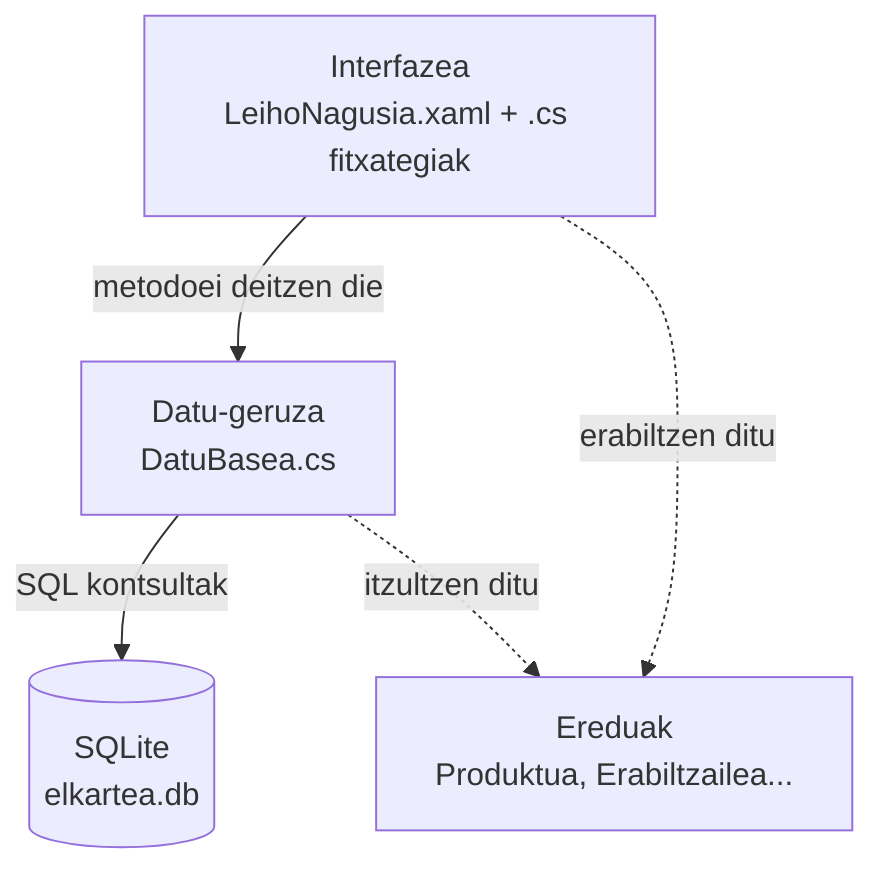
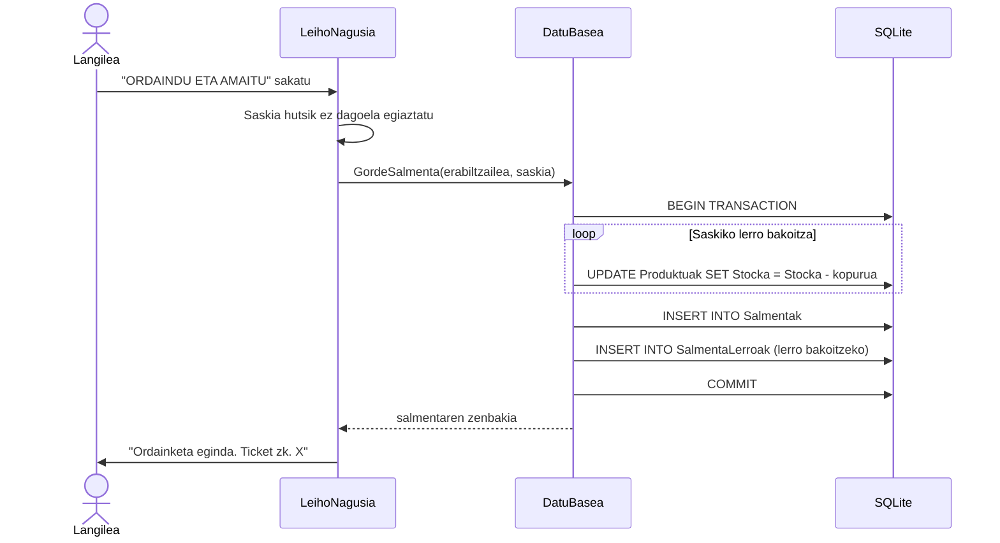
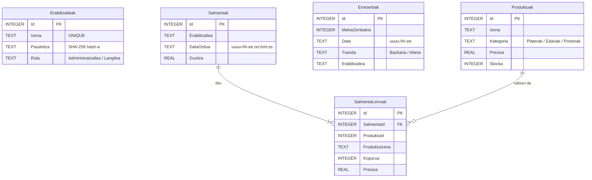

# TPV Elkartea — Dokumentazio teknikoa eta erabiltzaile-gida

## Aurkibidea

1. [Sarrera](#1-sarrera)
2. [Teknologiak](#2-teknologiak)
3. [Instalazioa eta exekuzioa](#3-instalazioa-eta-exekuzioa)
4. [Proiektuaren egitura](#4-proiektuaren-egitura)
5. [Arkitektura](#5-arkitektura)
6. [Datu-basea](#6-datu-basea)
7. [Klaseak](#7-klaseak)
8. [Erabiltzaile-gida](#8-erabiltzaile-gida)
9. [Balidazioak eta erroreak](#9-balidazioak-eta-erroreak)
10. [Probak](#10-probak)
11. [Mugak eta hobekuntza posibleak](#11-mugak-eta-hobekuntza-posibleak)
12. [Aldaketa-erregistroa](#12-aldaketa-erregistroa)

---

## 1. Sarrera

**TPV Elkartea** elkarte gastronomiko, taberna edo jatetxe txiki baterako salmenta-puntuko terminal (TPV) bat da. Windows-erako mahaigaineko aplikazioa da, eta datuak ordenagailuan bertan gordetzen ditu, SQLite datu-base batean. Ez du zerbitzaririk ezta Interneteko konexiorik behar.

### Helburuak

- Barrako edo jantokiko salmentak azkar erregistratzea.
- Produktuen stocka kontrolatzea: ezin da dagoena baino gehiago saldu.
- Jantokiko mahaien erreserbak kudeatzea, eguna eta txanda (bazkaria/afaria) kontuan hartuta.
- Administratzaileari produktuak, erabiltzaileak eta salmenten historia kudeatzeko aukera ematea.

### Erabiltzaile motak (rolak)

| Rola                  | Zer egin dezake                                                      |
|-----------------------|----------------------------------------------------------------------|
| **Langilea**          | Salmentak egin eta erreserbak sortu/ezeztatu.                        |
| **Administratzailea** | Langileak egin dezakeen guztia + *Administrazioa* fitxa osoa.        |

---

## 2. Teknologiak

| Teknologia                    | Bertsioa       | Zertarako                                    |
|-------------------------------|----------------|----------------------------------------------|
| C#                            | 14             | Programazio-lengoaia                         |
| .NET                          | 10 (`net10.0-windows`) | Exekuzio-ingurunea                   |
| WPF                           | .NET 10-ekoa   | Erabiltzaile-interfazea (XAML)               |
| SQLite                        | 3              | Datu-base lokala (fitxategi bakarra)         |
| `Microsoft.Data.Sqlite`       | 10.0.15        | C#-tik SQLite-ra konektatzeko NuGet paketea  |

---

## 3. Instalazioa eta exekuzioa

### Aurrebaldintzak

1. **Windows 10 edo 11** (WPF Windows-en bakarrik dabil).
2. **.NET 10 SDK** instalatuta. Egiaztatzeko:
   ```powershell
   dotnet --list-sdks
   ```
   `10.x.x` bertsioren bat agertu behar da.
3. (Aukerakoa) **Visual Studio 2022/2026**, *.NET desktop development* lan-kargarekin.

### Komando-lerrotik

Biltegiaren erroko karpetan:

```powershell
dotnet restore .\TPVelkartea\TPVelkartea.csproj
dotnet build   .\TPVelkartea\TPVelkartea.csproj
dotnet run     --project .\TPVelkartea\TPVelkartea.csproj
```

### Visual Studiotik

1. Ireki `TPVelkartea.slnx`.
2. Sakatu **F5** (edo *Hasi*).

### Lehen abiaraztea

Lehen aldiz abiaraztean aplikazioak automatikoki:

1. `Datuak/elkartea.db` datu-basea sortzen du exekutagarriaren karpetan (adibidez `bin\Debug\net10.0-windows\Datuak\elkartea.db`).
2. Taulak sortzen ditu.
3. Hasierako datuak (*seed*-a) sartzen ditu: 2 erabiltzaile eta 45 produktu.

> **Datuak hasierara itzultzeko**: itxi aplikazioa, ezabatu `elkartea.db` fitxategia eta abiarazi berriro.

---

## 4. Proiektuaren egitura

```text
TPV/
├── README.md                              Laburpena eta abiarazte azkarra
├── TPVelkartea.slnx                       Visual Studioko soluzioa
├── docs/
│   └── DOKUMENTAZIOA.md                   Dokumentu hau
└── TPVelkartea/
    ├── TPVelkartea.csproj                 Proiektuaren konfigurazioa eta NuGet paketeak
    ├── App.xaml / App.xaml.cs             Aplikazioaren hasiera (kultura: eu-ES)
    ├── AssemblyInfo.cs                    WPF-ren konfigurazioa (automatikoa)
    │
    ├── LeihoNagusia.xaml                  Interfaze osoaren diseinua (XAML)
    ├── LeihoNagusia.xaml.cs               Saioa hasi/itxi + metodo laguntzaileak
    ├── LeihoNagusia.Salmenta.cs           Salmenta fitxa: katalogoa, teklatua, saskia
    ├── LeihoNagusia.Erreserbak.cs         Erreserbak fitxa: planoa eta erreserbak
    ├── LeihoNagusia.Administrazioa.cs     Administrazioa fitxa: produktuak, erabiltzaileak, salmentak
    │
    ├── Ereduak/                           Datuen klaseak (modeloak)
    │   ├── Erabiltzailea.cs
    │   ├── Produktua.cs
    │   ├── SaskiLerroa.cs
    │   ├── Salmenta.cs
    │   ├── Erreserba.cs
    │   └── Mahaia.cs
    │
    └── Datuak/                            Datu-basearekin lotutako guztia
        ├── DatuBasea.cs                   SQL kontsulta guztiak
        └── HasierakoDatuak.cs             Seed-a: hasierako erabiltzaileak eta produktuak
```

### Zergatik `partial class`?

Leiho nagusiak hiru fitxa ditu (Salmenta, Erreserbak, Administrazioa). Kode guztia fitxategi bakarrean egongo balitz, 1.000 lerro inguruko fitxategia izango litzateke. C#-ko `partial class` erabiliz, klase bera (`LeihoNagusia`) hainbat fitxategitan bana daiteke: **fitxa bakoitzak bere fitxategia du**, eta errazagoa da kodea aurkitzea eta ulertzea.

---

## 5. Arkitektura

Aplikazioak hiru geruza sinple ditu:



- **Interfazea** (`LeihoNagusia`): botoien klikak jasotzen ditu, datuak balidatzen ditu eta pantaila eguneratzen du. **Ez du SQL-rik**.
- **Datu-geruza** (`DatuBasea`): SQL kontsulta guztiak hemen daude. Interfazeak ez daki datuak nola gordetzen diren.
- **Ereduak** (`Ereduak/` karpeta): datuak eramateko klase sinpleak (propietateak bakarrik, ia logikarik gabe).

Banaketa honi esker, adibidez, SQLite beste datu-base batengatik aldatu nahi izanez gero, `DatuBasea.cs` bakarrik aldatu beharko litzateke.

### Fluxu-adibidea: salmenta bat ordaintzea



Stockik ez badago produkturen batean, `ROLLBACK` egiten da eta **ez da ezer gordetzen**.

---

## 6. Datu-basea

### Entitate-erlazio diagrama



### Taulen azalpena

| Taula             | Zer gordetzen du                                                                                  |
|-------------------|---------------------------------------------------------------------------------------------------|
| `Erabiltzaileak`  | Aplikazioan sar daitezkeen pertsonak. `Izena` errepikaezina da.                                    |
| `Produktuak`      | Saltzen diren produktuak, beren kategoria, prezioa eta stocka.                                    |
| `Erreserbak`      | Mahai-erreserbak. `UNIQUE (MahaiZenbakia, Data, Txanda)`: mahai bat ezin da bi aldiz erreserbatu.  |
| `Salmentak`       | Salmenta bakoitzaren goiburua: nork, noiz eta zenbat guztira.                                     |
| `SalmentaLerroak` | Salmenta bakoitzaren xehetasuna: zein produktu, zenbat eta zein preziotan.                        |

### Diseinu-erabakiak

- **`SalmentaLerroak` taulan produktuaren izena eta prezioa ere gordetzen dira.** Horrela, produktu baten prezioa geroago aldatzen bada edo produktua ezabatzen bada, salmenta zaharrek beren benetako datuak mantentzen dituzte.
- **Pasahitzak ez dira testu arruntean gordetzen**, SHA-256 *hash* moduan baizik (`DatuBasea.PasahitzarenHasha`). Saioa hastean, idatzitako pasahitzaren hash-a kalkulatu eta datu-basekoarekin konparatzen da.
- **Datak testu moduan** gordetzen dira (`uuuu-hh-ee`), SQLite-k ez baitu data-mota berezirik. Formatu honekin testu-ordenak eta data-ordenak bat egiten dute.
- **Mahaiak ez daude datu-basean**: lokalaren planoa finkoa denez, kodean definituta daude (`LeihoNagusia.Erreserbak.cs`, `Mahaiak` array-a).

### Hasierako datuak (seed-a)

`Datuak/HasierakoDatuak.cs` fitxategian daude. Taula hutsik badago bakarrik sartzen dira, beraz aplikazioa berrabiarazteak ez ditu bikoizten.

| Kategoria    | Kopurua | Adibideak                                                      |
|--------------|---------|----------------------------------------------------------------|
| **Platerak** | 15      | Patata-tortilla, Txuleta, Bakailaoa pil-pilean, Etxeko kroketak |
| **Edariak**  | 24      | Zuritoa, Sagardo naturala, Txakolina, Patxarana, Kafesnea       |
| **Postreak** | 6       | Gazta-tarta, Mamia, Gazta Idiazabal irasagarrarekin             |

Produktu berriak gehitzeko, nahikoa da lerro bat gehitzea zerrendan:

```csharp
produktuak.Add(Sortu("Pintxo berezia", Produktua.Platerak, 2.50m, 30));
```

(Aldaketa ikusteko datu-basea ezabatu behar da, seed-a datu-base hutsean bakarrik sartzen baita.)

---

## 7. Klaseak

### 7.1 Ereduak (`Ereduak/` karpeta)

| Klasea           | Propietateak                                                         | Oharrak                                                                 |
|------------------|----------------------------------------------------------------------|-------------------------------------------------------------------------|
| `Erabiltzailea`  | `Id`, `Izena`, `Rola`                                                | `AdministratzaileaDa()` metodoa. Rolak konstante gisa: `Erabiltzailea.Administratzailea`, `Erabiltzailea.Langilea`. |
| `Produktua`      | `Id`, `Izena`, `Kategoria`, `Prezioa`, `Stocka`                      | Kategoriak konstante gisa: `Produktua.Platerak`, `Edariak`, `Postreak`. |
| `SaskiLerroa`    | `Produktua`, `Kopurua`, `Guztira` (kalkulatua)                       | `ToString()` → `"3 x Kafea = 4,50 €"` (ticket-ean agertzen den testua). |
| `Salmenta`       | `Id`, `Erabiltzailea`, `DataOrdua`, `Guztira`                        | Administrazioko salmenten taulan erakusteko.                            |
| `Erreserba`      | `Id`, `MahaiZenbakia`, `Data`, `Txanda`, `Erabiltzailea`             | Txandak konstante gisa: `Erreserba.Bazkaria`, `Erreserba.Afaria`.       |
| `Mahaia`         | `Zenbakia`, `Eserlekuak`, `X`, `Y`, `Zabalera`, `Altuera`, `Biribila` | Planoan marrazteko informazioa.                                         |

Testuak (rolak, kategoriak, txandak) **konstante** gisa definituta daude, idazketa-akatsak saihesteko: `"Administratzailea"` idatzi beharrean, `Erabiltzailea.Administratzailea` erabiltzen da, eta konpiladoreak berak abisatzen du gaizki idazten bada.

### 7.2 `DatuBasea` (`Datuak/DatuBasea.cs`)

| Metodoa                                         | Zer egiten du                                                            |
|-------------------------------------------------|--------------------------------------------------------------------------|
| `DatuBasea()`                                   | Konexioa prestatu, taulak sortu eta seed-a sartu (behar bada).           |
| `SaioaHasi(izena, pasahitza)`                   | Erabiltzailea itzultzen du datuak zuzenak badira; bestela `null`.        |
| `LortuErabiltzaileak()`                         | Erabiltzaile guztien zerrenda.                                           |
| `GordeErabiltzailea(erabiltzailea, pasahitza)`  | `Id = 0` bada sortu; bestela aldatu. Pasahitza hutsik → zaharra mantendu. |
| `EzabatuErabiltzailea(id)`                      | Erabiltzailea ezabatu.                                                   |
| `LortuProduktuak()`                             | Produktu guztiak, kategoriaka eta izenez ordenatuta.                     |
| `GordeProduktua(produktua)`                     | `Id = 0` bada sortu; bestela aldatu.                                     |
| `EzabatuProduktua(id)`                          | Produktua ezabatu.                                                       |
| `GordeSalmenta(erabiltzailea, saskia)`          | Salmenta gorde eta stocka jaitsi, **transakzio batean**. Ticket-zenbakia itzultzen du. |
| `LortuSalmentak()`                              | Salmenta guztiak, berrienetik hasita.                                    |
| `LortuErreserbak(data, txanda)`                 | Egun eta txanda bateko erreserbak.                                       |
| `GordeErreserba(mahaia, data, txanda, erabiltzailea)` | Erreserba sortu, mahaia libre badago.                              |
| `EzabatuErreserba(id)`                          | Erreserba ezeztatu.                                                      |

Kontsulta guztiek **parametroak** erabiltzen dituzte (`@izena`, `@id`...), testua zuzenean SQL-an kateatu beharrean. Horrela **SQL injekzioa** saihesten da.

```csharp
// ONDO: parametroekin
komandoa.CommandText = "SELECT ... WHERE Izena = @izena";
komandoa.Parameters.AddWithValue("@izena", izena);

// GAIZKI: testua kateatuta (SQL injekzioa posible)
komandoa.CommandText = "SELECT ... WHERE Izena = '" + izena + "'";
```

### 7.3 `LeihoNagusia` (interfazea)

| Fitxategia                          | Metodo nagusiak                                                                                   |
|-------------------------------------|---------------------------------------------------------------------------------------------------|
| `LeihoNagusia.xaml.cs`              | `SaioaHasi()`, `SaioaItxi_Click()`, eta laguntzaileak: `ErakutsiMezua()`, `Kolorea()`, `Euroak()` |
| `LeihoNagusia.Salmenta.cs`          | `KargatuProduktuak()`, `SortuProduktuTxartela()`, `Tekla_Click()`, `Gehitu_Click()`, `Ordaindu_Click()` |
| `LeihoNagusia.Erreserbak.cs`        | `KargatuMahaiak()`, `MarraztuMahaia()`, `Mahaia_Click()`, `Erreserbatu_Click()`, `EzeztatuErreserba_Click()` |
| `LeihoNagusia.Administrazioa.cs`    | `KargatuAdministrazioa()`, `GordeProduktua_Click()`, `GordeErabiltzailea_Click()`, `IrakurriPrezioa()` |

**Izendatze-arauak** proiektu osoan:

- Klaseak, metodoak eta propietateak: `PascalCase` (`GordeProduktua`, `MahaiZenbakia`).
- Aldagai pribatuak: azpimarrarekin hasita (`_datuBasea`, `_saskia`).
- Aldagai lokalak eta parametroak: `camelCase` (`produktua`, `salmentaZenbakia`).
- Gertaeren kudeatzaileak: `KontrolarenIzena_Gertaera` (`Ordaindu_Click`, `ProduktuTaula_SelectionChanged`).
- XAML-eko kontrolak: zer diren adierazten duen atzizkiarekin (`...Kutxa` testu-kutxetarako, `...Taula` DataGrid-etarako, `...Zerrenda` ListBox-etarako, `...Mezua` mezuetarako).

---

## 8. Erabiltzaile-gida

### 8.1 Saioa hastea

1. Idatzi **erabiltzailea** eta **pasahitza**.
2. Sakatu **SARTU** (edo **Enter** pasahitzaren kutxan).

Administratzailea bazara, *Administrazioa* fitxa ere agertuko da. Saioa ixteko, sakatu **Itxi saioa** goiko eskuinaldean (saskia hustu egiten da).

### 8.2 Salmenta bat egitea

```text
┌────────────┬───────────────────────────────┬──────────────────────┐
│ KATEGORIAK │  Produktuak        [BILATU ]  │  TICKET-A            │
│            │                               │  3 x Kafea = 4,50 €  │
│ Guztiak    │  ┌──────┐ ┌──────┐ ┌──────┐   │                      │
│ Platerak   │  │  🍽   │ │  🍺   │ │  🍰   │   │  KOPURUA        1    │
│ Edariak    │  │Izena │ │Izena │ │Izena │   │  [7][8][9]           │
│ Postreak   │  │8,50 €│ │2,20 €│ │5,50 €│   │  [4][5][6]           │
│            │  │GEHITU│ │GEHITU│ │GEHITU│   │  [1][2][3]           │
│            │  └──────┘ └──────┘ └──────┘   │  [C][0][⌫]           │
│            │                               │  GUZTIRA     4,50 €  │
│            │                               │  [ORDAINDU ETA AMAITU]│
└────────────┴───────────────────────────────┴──────────────────────┘
```

1. Ireki **🛒 Salmenta** fitxa.
2. (Aukerakoa) Aukeratu kategoria bat ezkerrean, edo idatzi produktuaren izenaren zati bat **BILATU** kutxan.
3. (Aukerakoa) Unitate bat baino gehiago gehitzeko, idatzi kopurua **teklatuan** (adibidez `3`). `C` garbitzeko, `⌫` azken zifra ezabatzeko.
4. Sakatu produktuaren **GEHITU** botoia. Kopurua 1era itzultzen da automatikoki.
5. Ticket-ean lerro bat kentzeko: aukeratu lerroa eta sakatu **Kendu lerroa**. Dena kentzeko: **Hustu saskia**.
6. Sakatu **ORDAINDU ETA AMAITU**. Ticket-zenbakia eta guztizkoa agertuko dira, eta stocka eguneratuko da.

Stocka 5 baino txikiagoa denean gorriz agertzen da. Stocka 0 denean, botoian **AGORTUTA** jartzen du eta ezin da sakatu.

### 8.3 Erreserba bat egitea

1. Ireki **📅 Erreserbak** fitxa.
2. Aukeratu **data** (gaurtik aurrera) eta **txanda** (*Bazkaria* edo *Afaria*).
3. Planoan, egin klik **libre** dagoen mahai batean (kolore marroi argia). Aukeratutako mahaia ertz morearekin nabarmentzen da.
4. Sakatu **ERRESERBATU MAHAI HAU**.

Mahai erreserbatuak arrosaz agertzen dira eta ezin dira aukeratu. Egun eta txanda horretako erreserbak eskuineko zerrendan ikusten dira. Bat ezeztatzeko: aukeratu zerrendan eta sakatu **Ezeztatu hautatutako erreserba** (berrespena eskatzen da).

### 8.4 Administrazioa

**⚙ Administrazioa** fitxak hiru azpi-fitxa ditu:

#### Produktuak

- **Produktu berria**: sakatu **Berria**, bete izena, kategoria, prezioa eta stocka, eta sakatu **Gorde**.
- **Produktu bat aldatu**: aukeratu taulan (datuak formularioan kargatzen dira), aldatu eta sakatu **Gorde**.
- **Stocka berritu**: aukeratu produktua, aldatu *Stocka* eremua eta sakatu **Gorde**.
- **Ezabatu**: aukeratu taulan eta sakatu **Ezabatu hautatutakoa** (berrespena eskatzen da).

Prezioa komarekin (`8,50`) edo puntuarekin (`8.50`) idatz daiteke.

#### Erabiltzaileak

- **Erabiltzaile berria**: sakatu **Berria**, bete izena, pasahitza eta rola, eta sakatu **Gorde**.
- **Aldatu**: aukeratu taulan, aldatu datuak eta sakatu **Gorde**. Pasahitza hutsik uzten bada, zaharra mantentzen da.
- **Ezabatu**: aukeratu eta sakatu **Ezabatu hautatutakoa**.

Segurtasunagatik, ezin duzu zure burua ezabatu ezta zure administratzaile-rola kendu ere.

#### Salmentak

Egindako salmenta guztien zerrenda (berrienak goian), eta goian **gaurko** salmenten kopurua eta diru-sarrera guztira.

---

## 9. Balidazioak eta erroreak

Erabiltzaileak ikusten dituen mezu guztiak euskaraz daude. Berdez agertzen dira ondo joan denean eta gorriz errore bat dagoenean.

| Egoera                                                  | Mezua                                                                  |
|---------------------------------------------------------|------------------------------------------------------------------------|
| Erabiltzailea edo pasahitza hutsik                      | *Idatzi erabiltzailea eta pasahitza.*                                  |
| Erabiltzailea/pasahitza okerra                          | *Erabiltzailea edo pasahitza ez da zuzena.*                            |
| Saskian stocka baino gehiago jarri                      | *Ez dago nahikoa stock: Kafea (12 geratzen dira).*                     |
| Saskia hutsik ordaintzean                               | *Saskia hutsik dago.*                                                  |
| Mahairik aukeratu gabe erreserbatu                      | *Aukeratu mahai bat planoan.*                                          |
| Iraganeko data                                          | *Ezin da iraganeko egun batean erreserbatu.*                           |
| Mahaia jada erreserbatuta                               | *Mahai hori dagoeneko erreserbatuta dago data eta txanda horretarako.* |
| Prezio okerra                                           | *Prezioa ez da zuzena (adibidez: 8,50).*                               |
| Stock negatiboa edo testua                              | *Stocka 0 edo zenbaki positibo bat izan behar da.*                     |
| Erabiltzaile-izen errepikatua                           | *Izen hori duen erabiltzaile bat badago jada.*                         |
| Erabiltzaile berria pasahitzik gabe                     | *Erabiltzaile berriak pasahitza behar du.*                             |
| Norberaren kontua ezabatu                               | *Ezin duzu zure burua ezabatu.*                                        |

Datu-geruzak arau-hausteak `InvalidOperationException` salbuespenarekin jakinarazten ditu; interfazeak `try/catch` batekin harrapatu eta mezua erakusten du, aplikazioa itxi gabe.

---

## 10. Probak

### 10.1 Datu-geruzaren probak (automatikoak)

`DatuBasea` klasea kontsola-programa batekin probatu da, datu-base huts batean. 22 proba, guztiak **ondo**:

| #  | Proba                                                                 | Emaitza |
|----|-----------------------------------------------------------------------|---------|
| 1  | Seed-ak 45 produktu sartzen ditu                                      | ✅      |
| 2  | Hiru kategoria daude                                                  | ✅      |
| 3  | Ez dago produktu-izen bikoiztuta                                      | ✅      |
| 4  | Seed-ak 2 erabiltzaile sartzen ditu                                   | ✅      |
| 5  | `admin`/`admin` sartzen da eta administratzailea da                   | ✅      |
| 6  | `langilea`/`langilea` sartzen da eta ez da administratzailea          | ✅      |
| 7  | Pasahitz okerrarekin ez da sartzen                                    | ✅      |
| 8  | Datu-basea berriz irekitzean seed-a ez da bikoizten                   | ✅      |
| 9  | Salmenta bat gordetzean ticket-zenbakia itzultzen da                  | ✅      |
| 10 | Salmentak stocka jaisten du (20 → 18)                                 | ✅      |
| 11 | Salmentaren guztizkoa zuzena da (2 × 8,50 + 3 × 1,50 = 21,50)         | ✅      |
| 12 | Stock nahikorik ez badago, errorea ematen du                          | ✅      |
| 13 | Errorearen ondoren beste produktuen stocka ez da aldatzen (*rollback*) | ✅     |
| 14 | Errorearen ondoren ez da salmentarik gordetzen                        | ✅      |
| 15 | Mahai bera bi aldiz ezin da erreserbatu (data eta txanda berean)      | ✅      |
| 16 | Mahai bera beste txanda batean erreserba daiteke                      | ✅      |
| 17 | Erreserba ezeztatu ondoren zerrenda hutsik dago                       | ✅      |
| 18 | Erabiltzaile berria sortu eta saioa has daiteke                       | ✅      |
| 19 | Erabiltzaile-izen errepikatua baztertzen da                           | ✅      |
| 20 | Pasahitza hutsik utzita aldatzean, zaharra mantentzen da              | ✅      |
| 21 | Prezio hamartarrak ondo gordetzen dira (2,75)                         | ✅      |
| 22 | Produktua ezabatu daiteke                                             | ✅      |

### 10.2 Interfazearen probak (eskuz)

| Proba                                                         | Espero dena                                       |
|---------------------------------------------------------------|---------------------------------------------------|
| `admin`-ekin sartu                                            | 3 fitxa ikusten dira                              |
| `langilea`-rekin sartu                                        | 2 fitxa bakarrik (Administrazioa ezkutuan)        |
| Teklatuan `3` sakatu eta produktu bat gehitu                  | Ticket-ean `3 x ...` agertzen da, kopurua 1era    |
| *Edariak* kategoria aukeratu                                  | Edariak bakarrik agertzen dira                    |
| Bilatzailean `sagardo` idatzi                                 | Sagardoak bakarrik agertzen dira                  |
| Ordaindu                                                      | Mezu berdea, saskia hutsik, stocka jaitsita       |
| Mahai bat erreserbatu                                         | Mahaia arrosaz agertzen da eta zerrendan ageri da |
| Txanda aldatu                                                 | Mahaia berriz libre agertzen da                   |
| Saioa itxi eta beste erabiltzaile batekin sartu               | Saskia hutsik dago                                |

---

## 11. Mugak eta hobekuntza posibleak

- **Txartel bidezko ordainketarik ez**: salmenta erregistratu egiten da, baina ez dago ordainketa-pasabiderik (dirua edo txartela bereizi gabe).
- **Ticket-a ez da inprimatzen**: pantailan bakarrik agertzen da. Etorkizunean PDF bat sortu edo inprimagailu termiko batera bidal liteke.
- **Txostenik ez**: salmentak ikus daitezke, baina ez dago egun/hilabeteko txostenik ezta Excelera esportatzerik ere.
- **Mahaiak kodean finkatuta**: lokalaren planoa aldatzeko kodea aldatu behar da. Hobekuntza bat izango litzateke mahaiak datu-basean gordetzea.
- **Salmenta baten xehetasuna**: `SalmentaLerroak` taulan gordetzen da, baina oraindik ez da interfazean erakusten.
- **Pasahitzen hash-a gatzik gabe**: SHA-256 testu arrunta baino askoz hobea da, baina benetako produkzio-ingurune batean *gatza* (salt) erabiltzen duen algoritmo bat (PBKDF2, bcrypt) hobea litzateke.
- **Erabiltzaile bakarreko aplikazioa**: datu-basea ordenagailu bakarrean dago. Hainbat terminal izateko, zerbitzari bateko datu-base bat beharko litzateke (MySQL, PostgreSQL...).

---

## 12. Aldaketa-erregistroa

### 2. bertsioa (berrantolaketa)

Aurreko bertsioarekin alderatuta:

**Antolaketa**
- `MainWindow.xaml.cs` (523 lerro, dena batera) lau fitxategitan banatu da `partial class` bidez: saioa, salmenta, erreserbak eta administrazioa.
- Ereduak fitxategi bakoitzean klase bat izateko banatu dira (`Ereduak/` karpeta).
- Seed-a bere fitxategira atera da (`Datuak/HasierakoDatuak.cs`).
- XAML-a lerro bakarretan pilatuta zegoen; orain koskatuta eta iruzkinduta dago, eta errepikatzen ziren estiloak (`Etiketa`, `Txartela`, `BotoiNagusia`...) behin bakarrik definitzen dira.

**Euskara**
- Kode osoa euskaraz: klaseak, metodoak, aldagaiak, taulak eta zutabeak.
- Seed-a euskaraz (lehen produktu gehienak gaztelaniaz zeuden) eta produktu bikoiztuak kenduta (*Txuleta* eta *Patata tortilla* bi aldiz sartzen ziren).
- Taulen zutabe-izenak euskaraz (lehen `Id`, `Name`, `Price`... ingelesez agertzen ziren).
- Zenbakiak eta datak euskal formatuan (`8,50 €`).

**Zuzendutako akatsak**
- Produktuen zerrendak ez zuen *scroll* egiten (`ScrollViewer` bat `StackPanel` baten barruan zegoen).
- Zenbaki-teklatuak ez zuen ezer egiten; orain hurrengo produktuaren kopurua aukeratzeko balio du.
- Mahai bat bi aldiz erreserbatzean aplikazioa itxi egiten zen (salbuespena ez zen harrapatzen).
- Errore-mezuak berdez agertzen ziren (arrakasta-mezuen kolorean).
- Saioa ixtean saskia ez zen husten: hurrengo erabiltzaileak aurrekoaren saskia ikusten zuen.
- Produktu bat aukeratuta zegoenean ezin zen produktu berririk sortu (beti aldatzen zuen hautatutakoa).
- Erabiltzaile bat aukeratzean bere datuak ez ziren formularioan kargatzen.
- Datu okerrak zeudenean ezer ez zen gertatzen, mezurik gabe; orain zer dagoen gaizki esaten da.
- Kategoria produktuaren izenetik asmatzen zen (`"cerveza"` → edaria); orain `Kategoria` zutabe bat dago.
- Irudiak Internetetik kargatzen ziren eta hiru irudi bakarrik zeuden produktu guztientzat; orain kategoriaren ikonoa erakusten da, konexiorik gabe.
- README-a UTF-16 kodeketan zegoen eta amaieran lerro bikoiztuak zituen.

**Hobekuntzak**
- Pasahitzak SHA-256 hash moduan gordetzen dira (lehen testu arruntean).
- Saskian ezin da stocka baino gehiago jarri.
- *Kendu lerroa* eta *Hustu saskia* botoiak.
- Egun eta txanda bateko erreserben zerrenda, eta erreserbak ezeztatzeko aukera.
- Ezin da iraganeko data batean erreserbatu.
- Salmenten historia eta gaurko laburpena administrazioan.
- Ezabatu aurretik berrespena eskatzen da.
- `Microsoft.Data.Sqlite` 9.0.5 → 10.0.15 eguneratu da (.NET 10-ekin bat etortzeko eta ahultasun ezagun bat zuen menpekotasun bat kentzeko).
