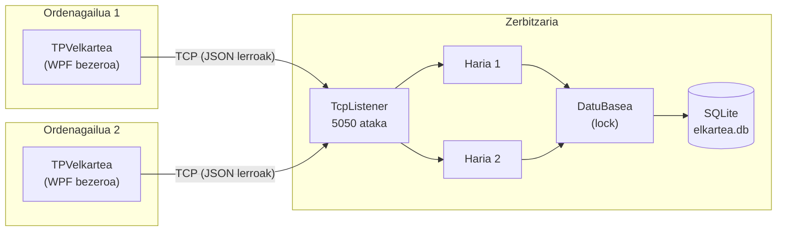
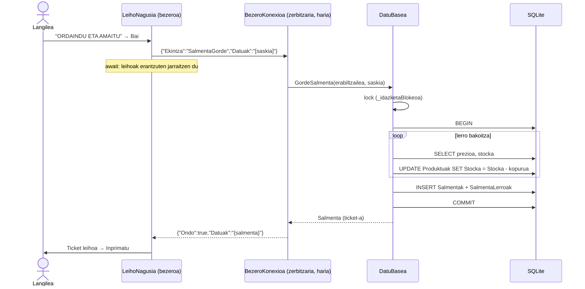
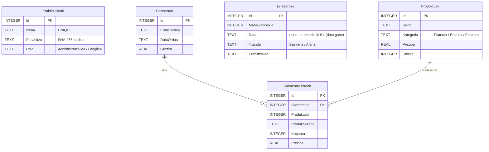

# TPV Elkartea — Dokumentazioa

## Aurkibidea

**I. zatia — Gida teknikoa**

1. [Sarrera](#1-sarrera)
2. [Eskakizunak eta nola betetzen diren](#2-eskakizunak-eta-nola-betetzen-diren)
3. [Teknologiak](#3-teknologiak)
4. [Instalazioa eta exekuzioa](#4-instalazioa-eta-exekuzioa)
5. [Proiektuaren egitura](#5-proiektuaren-egitura)
6. [Arkitektura: bezeroa eta zerbitzaria](#6-arkitektura-bezeroa-eta-zerbitzaria)
7. [Komunikazio-protokoloa](#7-komunikazio-protokoloa)
8. [Konkurrentzia: hariak eta blokeoak](#8-konkurrentzia-hariak-eta-blokeoak)
9. [Datu-basea](#9-datu-basea)
10. [Klaseak](#10-klaseak)
11. [Segurtasuna](#11-segurtasuna)
12. [Probak](#12-probak)
13. [Mugak eta hobekuntza posibleak](#13-mugak-eta-hobekuntza-posibleak)

**II. zatia — Administratzailearen gida**

14. [Saioa hastea](#14-saioa-hastea)
15. [Produktu berriak gehitu](#15-produktu-berriak-gehitu)
16. [Biltegiko stocka gehitu, aldatu eta ezabatu](#16-biltegiko-stocka-gehitu-aldatu-eta-ezabatu)
17. [Erabiltzaileak sortu, aldatu eta ezabatu](#17-erabiltzaileak-sortu-aldatu-eta-ezabatu)
18. [Salmenten historia](#18-salmenten-historia)

**III. zatia — Erabiltzailearen gida**

19. [Produktuak aukeratu eta ticket-a](#19-produktuak-aukeratu-eta-ticket-a)
20. [Mahai-erreserbak](#20-mahai-erreserbak)
21. [Mezuak eta erroreak](#21-mezuak-eta-erroreak)

---

# I. ZATIA — GIDA TEKNIKOA

## 1. Sarrera

**TPV Elkartea** elkarte gastronomiko baterako salmenta-puntuko terminal (TPV) bat da. Sistema komertzial bat baino merkeagoa izateko, mahaigaineko ordenagailu arruntetan instalatzen da.

Sistemak **bezero-zerbitzari** arkitektura du:

- **Zerbitzari** bakar batek SQLite datu-basea gordetzen eta kudeatzen du.
- **Bezeroak** (elkarteko ordenagailuak) zerbitzarira konektatzen dira **TCP** bidez. Gehienez **10 bezero** aldi berean.

### Erabiltzaile motak

| Rola                  | Funtzionalitateak                                                                                   |
|-----------------------|------------------------------------------------------------------------------------------------------|
| **Administratzailea** | Erabiltzaileak sortu/aldatu/ezabatu · Biltegiko stocka gehitu/aldatu/ezabatu · Produktu berriak · Salmenten historia · Langileak egin dezakeen guztia |
| **Langilea** (erabiltzaile komuna) | Saioa hasi · Kontsumoak aukeratu eta ticket-a inprimatu (guztizkoa kalkulatuta) · Mahai-erreserbak egin/aldatu/ezabatu |

---

## 2. Eskakizunak eta nola betetzen diren

| Eskakizuna                                                         | Non / nola                                                                                       |
|--------------------------------------------------------------------|--------------------------------------------------------------------------------------------------|
| 1) Login-interfazea                                                 | Leiho nagusiaren saio-hasiera panela (zerbitzariaren IPa + erabiltzailea + pasahitza)             |
| 2) Erabiltzaileak sortu/aldatu/ezabatu interfazea                   | *Administrazioa → Erabiltzaileak* fitxa                                                           |
| 3) Biltegiko stocka gehitu/aldatu/ezabatu interfazea                | *Administrazioa → Produktuak* fitxa (formularioa + "Biltegira sartu")                             |
| 4) Interfaze nagusia                                                | *Salmenta* fitxa: kategoriak, produktu-txartelak, kopuru-teklatua eta ticket-a                    |
| 5) Mahaiak erreserbatu (data zehaztuta edo gabe, bazkaria/afaria)   | *Erreserbak* fitxa: planoa, data / "Data zehaztu gabe" eta txanda                                 |
| Bi erabiltzaile mota                                                | `Administratzailea` eta `Langilea` rolak; zerbitzariak egiaztatzen ditu baimenak                  |
| Ticket-a inprimatu guztizkoarekin                                   | `TicketLeihoa`: produktuak, kopuruak, guztira + **Inprimatu** botoia (`PrintDialog`)              |
| Erreserbak egin/aldatu/ezabatu                                      | *Erreserbak* fitxako botoiak; langileak bereak bakarrik, administratzaileak denak                 |
| Informazio guztia SQLite datu-basean                                | `TPVelkartea.Zerbitzaria/Datuak/DatuBasea.cs`                                                     |
| Bezero-zerbitzari arkitektura, TCP                                  | `TcpListener` (zerbitzaria) eta `TcpClient` (bezeroa)                                             |
| Informazioa zentralizatuta zerbitzarian                             | Bezeroek ez dute datu-baserik; dena zerbitzariari eskatzen diote                                  |
| Gehienez 10 bezero aldi berean                                      | `Konfigurazioa.GehienezkoBezeroak = 10`; 11.ari "zerbitzaria beteta" erantzuten zaio              |
| Hari independentea bezero bakoitzeko                                | `new Thread(konexioa.Exekutatu)` bezero bakoitzeko                                                |
| Interfazeak funtzionatzen jarraitu erantzunaren zain                | Bezeroan `async`/`await`: leihoa ez da izozten                                                    |
| Eskualde kritikoak blokeatu (lock bakarra idazketetarako)           | `DatuBasea._idazketaBlokeoa`: idazten duten metodo guztiak `lock` baten barruan                   |
| Stocka automatikoki jaitsi erosketa baieztatzean                    | `DatuBasea.GordeSalmenta`: transakzio baten barruan                                               |
| Datu-baseen backupak                                                | Zerbitzariak abiaraztean (`VACUUM INTO`) + `Babeskopiak/elkartea_hasierakoa.db` biltegian         |
| Erabiltzaileak eta pasahitzak                                       | `ERABILTZAILEAK.md`                                                                               |
| README martxan jartzeko                                             | `README.md`                                                                                       |

---

## 3. Teknologiak

| Teknologia                | Bertsioa                 | Zertarako                                    |
|---------------------------|--------------------------|----------------------------------------------|
| C#                        | 14                       | Programazio-lengoaia                         |
| .NET                      | 10                       | Exekuzio-ingurunea                           |
| WPF                       | .NET 10-ekoa             | Bezeroaren interfazea (XAML)                 |
| TCP socketak              | `System.Net.Sockets`     | Bezeroaren eta zerbitzariaren arteko konexioa |
| JSON                      | `System.Text.Json`       | Mezuak testu bihurtzeko                      |
| SQLite                    | 3                        | Datu-basea (fitxategi bakarra)               |
| `Microsoft.Data.Sqlite`   | 10.0.15                  | C#-tik SQLite-ra konektatzeko (zerbitzarian) |

---

## 4. Instalazioa eta exekuzioa

### Aurrebaldintzak

1. **Windows 10 edo 11** (WPF bezeroak Windows behar du; zerbitzaria edozein sistematan dabil).
2. **.NET 10 SDK**. Egiaztatzeko: `dotnet --list-sdks` → `10.x.x` agertu behar da.
3. (Aukerakoa) **Visual Studio**, *.NET desktop development* lan-kargarekin.

### Komando-lerrotik

**1. urratsa — zerbitzaria** (beste leiho batean irekita utzi):

```powershell
dotnet run --project .\TPVelkartea.Zerbitzaria\TPVelkartea.Zerbitzaria.csproj
```

Kontsolan hau agertuko da:

```text
[12:08:17] Datu-basea: ...\Datuak\elkartea.db
[12:08:17] Babeskopia eginda: ...\Datuak\Babeskopiak\elkartea_20261119_120817.db
[12:08:17] Zerbitzaria martxan 5050 atakan. Gehienez 10 bezero.
```

**2. urratsa — bezeroa(k)**:

```powershell
dotnet run --project .\TPVelkartea\TPVelkartea.csproj
```

### Visual Studiotik

1. Ireki `TPVelkartea.slnx`.
2. Eskuin-klika soluzioan → **Configure Startup Projects** → **Multiple startup projects**.
3. `TPVelkartea.Zerbitzaria` eta `TPVelkartea`: biak **Start**. (Zerbitzaria lehenengo jarri zerrendan.)
4. **F5**.

### Hainbat ordenagailutan

1. Zerbitzaria ordenagailu batean abiarazi.
2. Ordenagailu horretako **Windows suebakian 5050 TCP ataka** ireki.
3. Beste ordenagailuetako bezeroetan, saio-hasieran, zerbitzariaren **IP helbidea** idatzi (adibidez `192.168.1.20`).

### Datuak hasierara itzultzea

Zerbitzaria gelditu, `Datuak\elkartea.db` ezabatu (edo `Babeskopiak/elkartea_hasierakoa.db`-rekin ordeztu, `elkartea.db` izena emanez) eta berriro abiarazi.

---

## 5. Proiektuaren egitura

Soluzioak hiru proiektu ditu:

```text
TPV/
├── README.md                        Martxan nola jarri
├── ERABILTZAILEAK.md                Erabiltzaileak, pasahitzak eta datu-basearen datuak
├── TPVelkartea.slnx                 Visual Studioko soluzioa
├── Babeskopiak/
│   └── elkartea_hasierakoa.db       Datu-basearen babeskopia (hasierako datuekin)
├── docs/
│   └── DOKUMENTAZIOA.md             Dokumentu hau
│
├── TPVelkartea.Komuna/              ── BIEK PARTEKATZEN DUTENA (liburutegia)
│   ├── Ereduak/                     Datuen klaseak
│   │   ├── Erabiltzailea.cs
│   │   ├── Produktua.cs
│   │   ├── SaskiLerroa.cs
│   │   ├── Salmenta.cs
│   │   ├── Erreserba.cs
│   │   └── Mahaia.cs
│   └── Protokoloa/                  Bezeroaren eta zerbitzariaren arteko "hizkuntza"
│       ├── Konfigurazioa.cs         Ataka (5050) eta gehienezko bezeroak (10)
│       ├── Ekintzak.cs              Ekintzen izenak (SaioaHasi, Produktuak...)
│       ├── Eskaera.cs               Bezeroak bidaltzen duena
│       ├── Erantzuna.cs             Zerbitzariak itzultzen duena
│       └── DatuMotak.cs             Ekintza batzuen datu-klase txikiak
│
├── TPVelkartea.Zerbitzaria/         ── ZERBITZARIA (kontsola)
│   ├── Program.cs                   Sarrera-puntua: datu-basea, babeskopia, zerbitzaria
│   ├── Zerbitzaria.cs               TcpListener + hari bat bezero bakoitzeko + 10eko muga
│   ├── BezeroKonexioa.cs            Bezero baten eskaerak prozesatu + baimenak
│   └── Datuak/
│       ├── DatuBasea.cs             SQL kontsulta guztiak + idazketa-blokeoa
│       └── HasierakoDatuak.cs       Seed-a: hasierako erabiltzaileak eta produktuak
│
└── TPVelkartea/                     ── BEZEROA (WPF)
    ├── App.xaml / App.xaml.cs       Aplikazioaren hasiera (kultura: eu-ES)
    ├── ZerbitzariBezeroa.cs         Zerbitzariarekin TCP bidez hitz egiten du (async)
    ├── LeihoNagusia.xaml            Interfaze nagusiaren diseinua
    ├── LeihoNagusia.xaml.cs         Saioa hasi/itxi + laguntzaileak
    ├── LeihoNagusia.Salmenta.cs     Salmenta fitxa
    ├── LeihoNagusia.Erreserbak.cs   Erreserbak fitxa
    ├── LeihoNagusia.Administrazioa.cs Administrazioa fitxa
    └── TicketLeihoa.xaml / .cs      Ticket-a erakutsi eta inprimatu
```

**Zergatik hiru proiektu?** Ereduak eta protokoloa bezeroak eta zerbitzariak berdin behar dituzte. `Komuna` liburutegian behin bakarrik idatzita, ezin dira bi aldeak "desberdin hitz egiten" hasi.

**Zergatik `partial class`?** Leiho nagusiak hiru fitxa ditu. Kode guztia fitxategi bakarrean egongo balitz, oso luzea izango litzateke. `partial` erabiliz, klase bera hainbat fitxategitan banatzen da: fitxa bakoitzak berea.

---

## 6. Arkitektura: bezeroa eta zerbitzaria



- **Bezeroak** ez du datu-baserik. Zerbait behar duenean (produktuak, salmenta bat gorde...) **eskaera** bat bidaltzen dio zerbitzariari eta **erantzuna**ren zain geratzen da.
- **Zerbitzariak** konexio bakoitzari **hari** bat ematen dio. Hari horrek bezero horren eskaerak irakurri, `DatuBasea` klasearekin exekutatu eta erantzuna itzultzen du.
- Informazio guztia **zentralizatuta** dago: datu-base bakarra, zerbitzarian.

### Salmenta baten fluxua



---

## 7. Komunikazio-protokoloa

Bezeroak eta zerbitzariak **testu-lerroak** trukatzen dituzte TCP konexioan. Lerro bakoitza **JSON** objektu bat da.

**Eskaera** (bezerotik zerbitzarira):

```json
{"Ekintza":"ErreserbaGorde","Datuak":"{\"MahaiZenbakia\":3,\"Data\":\"2026-11-20\",\"Txanda\":\"Afaria\"}"}
```

**Erantzuna** (zerbitzaritik bezerora):

```json
{"Ondo":false,"Mezua":"Mahai hori dagoeneko erreserbatuta dago txanda horretan.","Datuak":""}
```

- `Ekintza`: zer egin nahi den (`Ekintzak` klaseko konstante bat).
- `Datuak`: ekintzaren datuak, JSON testu gisa.
- `Ondo`: `false` bada, `Mezua`-n dago erabiltzaileari erakusteko errorea.

### Ekintzak

| Ekintza                | Datuak                          | Emaitza               | Nork        |
|------------------------|---------------------------------|-----------------------|-------------|
| `SaioaHasi`            | izena, pasahitza                | `Erabiltzailea`       | Edonork     |
| `Produktuak`           | —                               | `List<Produktua>`     | Saioa hasita |
| `ProduktuaGorde`       | `Produktua` (Id=0 → berria)     | —                     | Admin       |
| `ProduktuaEzabatu`     | id                              | —                     | Admin       |
| `StockaGehitu`         | produktu-id, kopurua            | —                     | Admin       |
| `Erabiltzaileak`       | —                               | `List<Erabiltzailea>` | Admin       |
| `ErabiltzaileaGorde`   | `Erabiltzailea` + pasahitza     | —                     | Admin       |
| `ErabiltzaileaEzabatu` | id                              | —                     | Admin       |
| `SalmentaGorde`        | `List<SaskiLerroa>`             | `Salmenta` (ticket-a) | Saioa hasita |
| `Salmentak`            | —                               | `List<Salmenta>`      | Admin       |
| `Erreserbak`           | data (edo ""), txanda           | `List<Erreserba>`     | Saioa hasita |
| `ErreserbaGorde`       | `Erreserba`                     | —                     | Saioa hasita |
| `ErreserbaAldatu`      | `Erreserba`                     | —                     | Jabea edo admin |
| `ErreserbaEzabatu`     | id                              | —                     | Jabea edo admin |

---

## 8. Konkurrentzia: hariak eta blokeoak

### Hari bat bezero bakoitzeko

`Zerbitzaria.Abiarazi()` metodoak begizta batean itxaroten du bezero berriak konektatu arte (`AcceptTcpClient`). Bezero bakoitzarentzat:

```csharp
BezeroKonexioa konexioa = new BezeroKonexioa(bezeroa, _datuBasea, this);
Thread haria = new Thread(konexioa.Exekutatu);
haria.IsBackground = true;
haria.Start();
```

Horrela, bezero bat zerbait egiten ari den bitartean, gainerakoak ere atenditzen dira.

### Gehienez 10 bezero

Konektatutako bezeroen kontagailua hari askok aldatzen dutenez, **`lock`** baten barruan aldatzen da:

```csharp
lock (_kontagailuBlokeoa)
{
    if (_bezeroKopurua >= Konfigurazioa.GehienezkoBezeroak)
        return false;          // 11. bezeroa: "Zerbitzaria beteta dago"
    _bezeroKopurua++;
    return true;
}
```

Bezero bat deskonektatzean (`finally` blokean), kontagailua jaisten da eta beste bati lekua uzten zaio.

### Idazketa-blokeo bakarra (eskualde kritikoa)

Bi erabiltzailek aldi berean taula bera aldatu nahi badute (adibidez, bi langilek azken antxoak saldu, edo mahai bera erreserbatu), arazoak egon litezke. Horregatik, `DatuBasea` klaseak **blokeo bakar bat** du datu-basean idazten duten eragiketa guztientzat:

```csharp
private readonly object _idazketaBlokeoa = new object();

public void GordeErreserba(Erreserba erreserba)
{
    lock (_idazketaBlokeoa)
    {
        if (MahaiaOkupatutaDago(erreserba))   // 1. begiratu
            throw new InvalidOperationException("...");
        // 2. gorde
    }
}
```

"Begiratu" eta "gorde" lock beraren barruan daudenez, ezin da gertatu bi harik mahaia libre ikustea eta biek gordetzea. Hari batek lock-a duen bitartean, besteak itxaron egiten du.

Irakurketek (produktuak zerrendatu, adibidez) ez dute lock-ik behar: SQLite-k berak bermatzen du irakurketa koherentea.

### Bezeroa ez da izozten

Bezeroan, zerbitzariari deitzen dioten metodoak **asinkronoak** dira:

```csharp
private async void Ordaindu_Click(object sender, RoutedEventArgs e)
{
    Salmenta salmenta = await _zerbitzaria.GordeSalmentaAsync(_saskia);
    ...
}
```

`await` bitartean, WPF-k leihoa margotzen eta klikak jasotzen jarraitzen du. `ZerbitzariBezeroa` klaseak `SemaphoreSlim` bat du, eskaera bat bakarrik aldi berean bidaltzeko (bestela bi erantzun nahas litezke konexio berean).

---

## 9. Datu-basea

Zerbitzariak bakarrik ukitzen du. Fitxategia: `Datuak\elkartea.db`, zerbitzariaren exekutagarriaren karpetan.



### Diseinu-erabakiak

- **Data gabeko erreserbak**: `Data` zutabea `NULL` da. Erreserba horrek mahaia txanda horretan **egun guztietan** okupatzen du. Beraz:
  - Data jakin bateko erreserbak bilatzean, data gabekoak ere agertzen dira.
  - Mahai batek data gabeko erreserba badu, ezin da txanda horretan data batekin erreserbatu, eta alderantziz.
- **Prezioak zerbitzarian**: salmenta bat gordetzean, zerbitzariak produktuaren prezioa datu-basetik irakurtzen du. Bezero batek prezio faltsu bat bidaliko balu ere, ez luke eraginik.
- **`SalmentaLerroak` taulan izena eta prezioa gordetzen dira**: produktua geroago aldatu edo ezabatzen bada ere, salmenta zaharrek beren datuak mantentzen dituzte.
- **Transakzioak**: salmenta batean stocka jaitsi, goiburua gorde eta lerroak gorde transakzio bakarrean egiten da. Zerbaitek huts egiten badu, ez da ezer gordetzen.
- **Datak testu gisa** (`uuuu-hh-ee`): formatu honekin testu-ordena eta data-ordena berdinak dira.

### Babeskopiak

Zerbitzaria abiarazten den bakoitzean, `DatuBasea.EginBabeskopia()` metodoak kopia bat egiten du:

```sql
VACUUM INTO 'Datuak/Babeskopiak/elkartea_20261119_120817.db'
```

SQLite-ren agindu honek kopia osoa eta koherentea sortzen du. Gainera, biltegian `Babeskopiak/elkartea_hasierakoa.db` dago (hasierako datuekin).

### Hasierako datuak (seed-a)

`TPVelkartea.Zerbitzaria/Datuak/HasierakoDatuak.cs`. Taula hutsik badago bakarrik sartzen dira:

- 2 erabiltzaile: `admin` / `admin` (Administratzailea) eta `langilea` / `langilea` (Langilea).
- 45 produktu: 15 **Platerak** (Patata-tortilla, Txuleta, Bakailaoa pil-pilean...), 24 **Edariak** (Zuritoa, Sagardo naturala, Txakolina, Patxarana...), 6 **Postreak** (Gazta-tarta, Mamia...).

---

## 10. Klaseak

### 10.1 `TPVelkartea.Komuna`

| Klasea          | Edukia                                                                           |
|-----------------|----------------------------------------------------------------------------------|
| `Erabiltzailea` | `Id`, `Izena`, `Rola`, `AdministratzaileaDa()`. Rolak konstante gisa.            |
| `Produktua`     | `Id`, `Izena`, `Kategoria`, `Prezioa`, `Stocka`. Kategoriak konstante gisa.      |
| `SaskiLerroa`   | `Produktua`, `Kopurua`, `Guztira` (kalkulatua).                                  |
| `Salmenta`      | `Id`, `Erabiltzailea`, `DataOrdua`, `Guztira`, `Lerroak` (ticket-erako).         |
| `Erreserba`     | `Id`, `MahaiZenbakia`, `Data` ("" = data gabe), `Txanda`, `Erabiltzailea`.       |
| `Mahaia`        | Planoko mahai bat: zenbakia, eserlekuak, posizioa eta tamaina.                   |
| `Konfigurazioa` | `Ataka = 5050`, `GehienezkoBezeroak = 10`.                                       |
| `Ekintzak`      | Ekintzen izenak konstante gisa.                                                  |
| `Eskaera` / `Erantzuna` | Sarean bidaltzen diren mezuak.                                           |

### 10.2 `TPVelkartea.Zerbitzaria`

| Klasea            | Ardura                                                                                         |
|-------------------|-------------------------------------------------------------------------------------------------|
| `Program`         | Datu-basea ireki, babeskopia egin eta zerbitzaria abiarazi.                                     |
| `Zerbitzaria`     | `TcpListener`; bezero bakoitzeko haria sortu; 10eko muga (`lock` kontagailuarekin).             |
| `BezeroKonexioa`  | Bezero baten haria: lerroak irakurri, `Eskaera` → ekintza → `Erantzuna`. Saioko erabiltzailea gordetzen du eta **baimenak** egiaztatzen ditu. |
| `DatuBasea`       | SQL guztia. Idazten duten metodoak `lock (_idazketaBlokeoa)` barruan.                           |
| `HasierakoDatuak` | Seed-a.                                                                                         |

### 10.3 `TPVelkartea` (bezeroa)

| Klasea / fitxategia                | Ardura                                                                             |
|------------------------------------|------------------------------------------------------------------------------------|
| `ZerbitzariBezeroa`                | TCP konexioa; `...Async` metodo bat ekintza bakoitzeko.                            |
| `LeihoNagusia.xaml.cs`             | Saioa hasi/itxi; `ErakutsiMezua`, `Kolorea`, `Euroak` laguntzaileak.               |
| `LeihoNagusia.Salmenta.cs`         | Katalogoa (txartelak), kategoriak, bilaketa, teklatua, saskia, ordaindu.           |
| `LeihoNagusia.Erreserbak.cs`       | Planoa marraztu (mahaiak eta aulkiak), erreserbak egin/aldatu/ezabatu.             |
| `LeihoNagusia.Administrazioa.cs`   | Produktuak, stocka, erabiltzaileak eta salmenten taulak.                           |
| `TicketLeihoa`                     | Ticket-a erakutsi eta `PrintDialog` bidez inprimatu.                               |

### Izendatze-arauak

- Klaseak, metodoak eta propietateak: `PascalCase` (`GordeProduktua`).
- Eremu pribatuak: azpimarrarekin (`_datuBasea`, `_saskia`).
- Aldagai lokalak eta parametroak: `camelCase` (`salmentaZenbakia`).
- Metodo asinkronoak: `Async` atzizkiarekin (`LortuProduktuakAsync`).
- XAML kontrolak: motaren atzizkiarekin (`...Kutxa`, `...Taula`, `...Zerrenda`, `...Botoia`).

---

## 11. Segurtasuna

- **Baimenak zerbitzarian**: saioa hasten denean, zerbitzariak erabiltzailea gordetzen du konexio horretan (`BezeroKonexioa._erabiltzailea`). Ondorengo eskaera guztietan **zerbitzariak** erabakitzen du administratzailea den ala ez; bezeroak ezin du bere rola "asmatu".
- **Saioa hasi gabe**, `SaioaHasi` ez den beste edozein ekintza baztertzen da.
- **Pasahitzak** SHA-256 hash moduan gordetzen dira.
- **SQL injekzioa** saihesteko, kontsulta guztiek parametroak erabiltzen dituzte (`@izena`, `@id`...).
- **Prezioak** zerbitzarian kalkulatzen dira (ez dira bezeroaz fidatzen).
- **TCP**: protokolo fidagarria da; datuak ordenan eta galerarik gabe iristen dira. Konexioa ez dago zifratuta (ikus 13. atala).

---

## 12. Probak

### 12.1 Bezero-zerbitzari probak (automatikoak)

Zerbitzaria abiarazi eta proba-programa batek **benetako `ZerbitzariBezeroa` klasea** erabiliz hainbat bezero konektatu ditu. 26 proba, guztiak **ondo**:

| #  | Proba                                                                                          | Emaitza |
|----|------------------------------------------------------------------------------------------------|---------|
| 1  | Saioa hasi gabe ezin da produkturik eskatu                                                      | ✅ |
| 2  | Pasahitz okerra baztertzen da                                                                   | ✅ |
| 3  | `admin` eta `langilea` sartzen dira                                                             | ✅ |
| 4  | Langileak ezin ditu erabiltzaileak ikusi                                                        | ✅ |
| 5  | Langileak ezin du produkturik gorde                                                             | ✅ |
| 6  | Langileak ezin du stockik gehitu                                                                | ✅ |
| 7  | Seed-ak 45 produktu ditu                                                                        | ✅ |
| 8  | Prezio faltsua bidalita ere, zerbitzariak DBko prezioa erabiltzen du (2 × 1,50 = 3,00)          | ✅ |
| 9  | Ticket-ak lerroak dakartza (izena eta kopurua)                                                  | ✅ |
| 10 | Stock gutxiegi → baztertua                                                                      | ✅ |
| 11 | Stocka gehitu: 100 − 2 + 10 = 108                                                               | ✅ |
| 12 | **8 bezerok aldi berean** produktu bera erosi (stocka 10, bakoitzak 2): 5 onartuak, stocka 0    | ✅ |
| 13 | **11. bezeroa** baztertua: "Zerbitzaria beteta dago (gehienez 10 bezero)"                       | ✅ |
| 14 | Bezeroak deskonektatu ondoren, berri bat sar daiteke                                            | ✅ |
| 15 | **6 bezerok aldi berean** mahai bera erreserbatu: 1 bakarra onartua                             | ✅ |
| 16 | Data gabeko erreserbak mahaia egun guztietan okupatzen du                                       | ✅ |
| 17 | Data gabeko erreserbak beste txanda ez du okupatzen                                             | ✅ |
| 18 | Data bateko zerrendan data gabeko erreserbak agertzen dira                                      | ✅ |
| 19 | Mahai batek dataduna badu, ezin da data gabe erreserbatu                                        | ✅ |
| 20 | Iraganeko data baztertzen da                                                                    | ✅ |
| 21 | Langileak ezin du adminaren erreserba ezabatu                                                   | ✅ |
| 22 | Langileak bere erreserba alda dezake                                                            | ✅ |
| 23 | Aldaketa datu-basean gordeta dago                                                               | ✅ |
| 24 | Administratzaileak edozein erreserba ezaba dezake                                               | ✅ |
| 25 | Administratzaileak ezin du bere burua ezabatu                                                   | ✅ |
| 26 | Erabiltzaile berria sortu eta saioa has daiteke                                                 | ✅ |

12. eta 15. probek erakusten dute **idazketa-blokeoak** funtzionatzen duela: aldi bereko eskaerekin ere, ez da stock negatiborik ezta erreserba bikoitzik sortzen.

### 12.2 Interfazearen probak (eskuz)

| Proba                                                         | Espero dena                                       |
|---------------------------------------------------------------|---------------------------------------------------|
| Zerbitzaria itzalita dagoela sartu                            | "Ezin da zerbitzarira konektatu..." mezua          |
| `admin`-ekin sartu                                            | 3 fitxa (Salmenta, Erreserbak, Administrazioa)     |
| `langilea`-rekin sartu                                        | 2 fitxa (Administrazioa ezkutuan)                  |
| Teklatuan `2` eta *Kafea* → GEHITU                            | Ticket-ean `2 x Kafea = 3,00 €`                    |
| Ordaindu → Bai                                                | Ticket leihoa; *Inprimatu* → inprimatze-leihoa     |
| Bi bezerotan produktu bera saldu                              | Bigarrenean stock eguneratua ikusten da            |
| "Data zehaztu gabe" markatu eta erreserbatu                   | Erreserba "data gabe" agertzen da                  |
| Erreserba bat aukeratu → *Aldatu* → mahai berria → *Gorde*    | Erreserba mahai berrira mugituta                   |

---

## 13. Mugak eta hobekuntza posibleak

- **Konexioa ez dago zifratuta**: TCP fidagarria da, baina sare lokaletik ateratzeko `SslStream` (TLS) erabili beharko litzateke.
- **Txartel bidezko ordainketarik ez**: salmenta erregistratzen da, baina ez dago ordainketa-pasabiderik.
- **Mahaiak kodean finkatuta**: planoa aldatzeko kodea aldatu behar da. Datu-basean gorde litezke.
- **Bezeroak ez dira automatikoki eguneratzen**: beste bezero batek zerbait aldatzen badu, ikusteko fitxa berriz kargatu behar da (adibidez, saioa itxi eta hasi, edo ekintza bat egin).
- **Pasahitzen hash-a gatzik gabe**: SHA-256 testu arrunta baino hobea da, baina produkzioan PBKDF2 edo bcrypt hobea litzateke.

---

# II. ZATIA — ADMINISTRATZAILEAREN GIDA

## 14. Saioa hastea

1. Ziurtatu **zerbitzaria martxan** dagoela.
2. Ireki **TPV Elkartea** aplikazioa.
3. Bete:
   - **Zerbitzaria (IP helbidea)**: `127.0.0.1` ordenagailu berean bada; bestela, zerbitzariaren IPa.
   - **Erabiltzailea** eta **pasahitza** (adibidez `admin` / `admin`).
4. Sakatu **SARTU** (edo Enter).

Administratzaile gisa, hiru fitxa ikusiko dituzu: **🛒 Salmenta**, **📅 Erreserbak** eta **⚙ Administrazioa**.

## 15. Produktu berriak gehitu

*⚙ Administrazioa → Produktuak*

1. Sakatu **Berria** (formularioa garbitzeko).
2. Bete:
   - **Izena**: adibidez `Pintxo berezia`.
   - **Kategoria**: *Platerak*, *Edariak* edo *Postreak*.
   - **Prezioa (€)**: `2,50` edo `2.50`.
   - **Stocka**: hasierako unitateak, adibidez `30`.
3. Sakatu **Gorde**.

Produktua taulan eta *Salmenta* fitxako katalogoan agertuko da.

## 16. Biltegiko stocka gehitu, aldatu eta ezabatu

*⚙ Administrazioa → Produktuak*

### Stocka gehitu (biltegira unitate berriak sartu)

1. Aukeratu produktua taulan.
2. **BILTEGIRA SARTU (UNITATEAK)** eremuan idatzi zenbat unitate iritsi diren (adibidez `24`).
3. Sakatu **+ Gehitu**.

Batuketa zerbitzarian egiten da (`Stocka = Stocka + 24`), beraz bi administratzailek aldi berean gehitzen badute ere, ez da ezer galtzen.

### Stocka (edo beste datu bat) aldatu

1. Aukeratu produktua taulan: bere datuak formularioan kargatzen dira.
2. Aldatu **Stocka** (edo izena, kategoria, prezioa).
3. Sakatu **Gorde**.

### Produktua ezabatu

1. Aukeratu produktua taulan.
2. Sakatu **Ezabatu hautatutakoa** eta baieztatu.

Lehendik egindako salmentek produktuaren izena eta prezioa gordeta dituzte, beraz historia ez da galtzen.

## 17. Erabiltzaileak sortu, aldatu eta ezabatu

*⚙ Administrazioa → Erabiltzaileak*

### Sortu

1. Sakatu **Berria**.
2. Bete **Izena**, **Pasahitza** eta **Rola** (*Administratzailea* edo *Langilea*).
3. Sakatu **Gorde**.

### Aldatu

1. Aukeratu erabiltzailea taulan.
2. Aldatu izena edo rola. Pasahitza aldatzeko, idatzi berria; **hutsik uzten bada, zaharra mantentzen da**.
3. Sakatu **Gorde**.

### Ezabatu

1. Aukeratu erabiltzailea taulan.
2. Sakatu **Ezabatu hautatutakoa** eta baieztatu.

Segurtasunagatik, ezin duzu **zure burua ezabatu** ezta **zure administratzaile-rola kendu** ere.

## 18. Salmenten historia

*⚙ Administrazioa → Salmentak*: salmenta guztien zerrenda (berrienak goian) eta goian gaurko salmenten kopurua eta guztizkoa.

---

# III. ZATIA — ERABILTZAILEAREN GIDA

## 19. Produktuak aukeratu eta ticket-a

*🛒 Salmenta* fitxa. Produktuak **ikus-osagaien** bidez aukeratzen dira: kategoria-botoiak, produktu-txartelak (ikonoa, izena, prezioa eta stocka) eta zenbaki-teklatua.

```text
┌────────────┬───────────────────────────────┬──────────────────────┐
│ KATEGORIAK │  Produktuak        [BILATU ]  │  TICKET-A            │
│            │  ┌──────┐ ┌──────┐ ┌──────┐   │  2 x Kafea = 3,00 €  │
│ Guztiak    │  │  🍽   │ │  🍺   │ │  🍰   │   │                      │
│ Platerak   │  │Izena │ │Izena │ │Izena │   │  KOPURUA        1    │
│ Edariak    │  │8,50 €│ │1,50 €│ │5,50 €│   │  [7][8][9]           │
│ Postreak   │  │GEHITU│ │GEHITU│ │GEHITU│   │  [4][5][6] [1][2][3] │
│            │  └──────┘ └──────┘ └──────┘   │  [C][0][⌫]           │
│            │                               │  GUZTIRA     3,00 €  │
│            │                               │  [ORDAINDU ETA AMAITU]│
└────────────┴───────────────────────────────┴──────────────────────┘
```

1. (Aukerakoa) Aukeratu **kategoria** bat ezkerrean, edo idatzi izenaren zati bat **BILATU** kutxan.
2. (Aukerakoa) Unitate bat baino gehiago nahi badituzu, idatzi kopurua **teklatuan** (`C` garbitu, `⌫` azken zifra ezabatu).
3. Sakatu produktuaren **GEHITU** botoia. Ticket-ean agertzen da, eta **GUZTIRA** automatikoki kalkulatzen da.
4. Okerren bat? Aukeratu lerroa eta **Kendu lerroa**, edo **Hustu saskia**.
5. Sakatu **ORDAINDU ETA AMAITU** → leiho batek produktu kopurua eta guztizkoa erakusten ditu → **Bai**.
6. Erosketa baieztatzean:
   - Zerbitzariak salmenta gordetzen du eta **produktu bakoitzaren stocka automatikoki jaisten du** datu-basean.
   - **Ticket-a** agertzen da: zenbakia, data, langilea, produktuak eta kantitateak, eta ordaindu beharreko **guztira**.
   - Sakatu **🖨 Inprimatu** inprimagailua aukeratzeko, edo **Itxi**.

Stocka 5 baino txikiagoa denean gorriz agertzen da; 0 denean, botoian **AGORTUTA** jartzen du.

## 20. Mahai-erreserbak

*📅 Erreserbak* fitxa. Mahaiak **ikus-osagaien** bidez aukeratzen dira: jantokiaren planoa, mahai bakoitza bere aulkiekin eta egoerarekin (koloreak).

| Kolorea              | Esanahia                 |
|----------------------|--------------------------|
| Marroi argia         | Libre                    |
| Arrosa               | Erreserbatua             |
| Ertz morea           | Aukeratuta               |

### Erreserba egin

1. Aukeratu **data** (gaurtik aurrera) **edo** markatu **Data zehaztu gabe**.
2. Aukeratu **txanda**: *Bazkaria* edo *Afaria*.
3. Planoan, egin klik **libre** dagoen mahai batean.
4. Sakatu **ERRESERBATU MAHAI HAU**.

**Data zehaztu gabe** egindako erreserbak mahai hori txanda horretan **egun guztietan** okupatzen du (adibidez, elkartekide batek ostiraleko afaria beti gordeta izateko).

### Erreserba aldatu

1. Eskuineko zerrendan, aukeratu erreserba.
2. Sakatu **Aldatu hautatutakoa**. Formularioa erreserbaren datuekin betetzen da ("ERRESERBA ALDATZEN").
3. Aldatu data, txanda edo mahaia (planoan).
4. Sakatu **GORDE ALDAKETAK** (edo **Utzi aldaketa**).

### Erreserba ezabatu

1. Aukeratu erreserba zerrendan.
2. Sakatu **Ezabatu hautatutakoa** eta baieztatu.

Langile batek **bere** erreserbak bakarrik alda eta ezaba ditzake; administratzaileak denak.

## 21. Mezuak eta erroreak

Mezu guztiak euskaraz daude: **berdez** ondo joan denean, **gorriz** errore bat dagoenean.

| Egoera                                         | Mezua                                                                 |
|------------------------------------------------|-----------------------------------------------------------------------|
| Zerbitzaria itzalita edo IP okerra              | *Ezin da zerbitzarira konektatu (…:5050). Zerbitzaria martxan dago?*   |
| 10 bezero konektatuta jada                     | *Zerbitzaria beteta dago (gehienez 10 bezero). Saiatu geroago.*        |
| Erabiltzailea/pasahitza okerra                  | *Erabiltzailea edo pasahitza ez da zuzena.*                            |
| Zerbitzariarekin konexioa galdu da              | *Zerbitzariarekin konexioa galdu da. Hasi saioa berriro.*              |
| Stock nahikorik ez                              | *Ez dago nahikoa stock: Kafea (12 geratzen dira).*                     |
| Saskia hutsik ordaintzean                       | *Saskia hutsik dago.*                                                  |
| Mahairik aukeratu gabe                          | *Aukeratu mahai bat planoan.*                                          |
| Mahaia okupatuta                                | *Mahai hori dagoeneko erreserbatuta dago txanda horretan.*             |
| Iraganeko data                                  | *Ezin da iraganeko egun batean erreserbatu.*                           |
| Beste baten erreserba aldatu/ezabatu (langilea) | *Beste erabiltzaile baten erreserba ezin duzu aldatu edo ezabatu.*     |
| Langileak administrazio-ekintza bat             | *Ekintza hau administratzaileek bakarrik egin dezakete.*               |
| Prezio okerra                                   | *Prezioa ez da zuzena (adibidez: 8,50).*                               |
| Izen errepikatua                                | *Izen hori duen erabiltzaile bat badago jada.*                         |
| Norberaren kontua ezabatu                       | *Ezin duzu zure burua ezabatu.*                                        |
